# Stormcast: machine learning forecasts the market's weather, not its direction

*Class project report. Author: the team. Code and data pipeline: this repository. Pre-registered plan:
`docs/plan.md`.*

## Abstract
We give machine-learning models the same 25 features and ask two questions about the next 30 minutes of E-mini S&P 500
futures. Will the price go up or down? How much will it move? We use one-minute bars from 2010 to 2019, expanding-window
walk-forward validation, and a plan fixed before any model was fit. Final evaluation was a single run on 2016–2019.

The two answers could hardly differ more:
- **Direction:** the best model reaches an AUC of 0.522 (95% CI 0.511–0.533). The signal is statistically detectable but
  tiny, and it is worth 0.01 index points per trade against a trading cost of 0.70.
- **Volatility:** the best model explains 83% of the variance of log realized volatility. Gradient boosting beats the
  classical HAR model in every test year.

We then show what reliable volatility forecasts are good for:
- **Prediction intervals.** Adaptive conformal intervals keep 90% coverage through the February 2018 volatility shock;
  model-based intervals collapse to 33–46%.
- **Regimes.** A hidden Markov model separates calm from stormy days (η² = 0.51 for the next day's volatility) but says
  nothing about direction (η² = 0.0001).
- **Risk.** Sizing positions by the forecast cuts daily loss-limit breaches from 4.0% of days to 0.2% at the same average
  size.

Finally, a "leak lab" plants six common mistakes in the direction task. Two of them inflate a coin-flip model to AUC
0.76 and 0.96. Picking the best of 200 random rules each quarter produces an average in-sample Sharpe ratio of 3.6, which
turns into −0.7 the next quarter.

## 1. Motivation
This project grew out of the team's trading-research project (AlphaBench). It tested 24 published intraday rules and
two machine-learning ideas on ES futures, and found no edge after costs. A machine-learning ensemble scored AUC 0.51,
and a pure-noise feature ranked as its most important input. A negative result like that raises a natural question.
Is one-minute futures data simply unpredictable, or is *direction* specifically the hard part?

Finance theory predicts the split we test. In an efficient market, predictable price changes are traded away
(Fama, 1970). Volatility, however, clusters: large moves follow large moves (Mandelbrot, 1963). It also follows a strong
intraday pattern (Andersen & Bollerslev, 1997). Nothing arbitrages that away, because knowing a big move is coming does
not tell you which way to bet. This project measures both sides of that split with identical machinery.

## 2. Data
- **Futures:** ES one-minute OHLCV bars from Databento (CME Globex), continuous front contract with a forward
  (point-in-time) roll adjustment. The span is 2010-06-07 to 2019-05-21: 3.1 million bars and 2,286 trading days after
  dropping the vendor's flagged degraded days. This is AlphaBench's exploration window. Its later data is reserved for
  the trading project's own one-shot tests, and our loader refuses any bar after 2019-05-21 (tested).
- **VIX:** official Cboe daily closes. Day D uses only the close of the previous trading day.
- **FOMC:** statement dates from the Federal Reserve's historical pages. Meetings are scheduled in advance, so the flag
  is known before the day starts.

## 3. Design
**Samples.** Decision points fall every 30 minutes in the cash session, from 10:00 to 15:30 ET (12 per day,
26,880 in total). Horizons never overlap.

**Targets** (next 30 one-minute bars):
- *direction*: the close 30 minutes later is above the last close before the decision;
- *volatility*: log realized variance, the sum of squared one-minute log returns;
- *range*: the log of the high-low range, used for intervals.

**Features** (all computed from bars that closed before the decision):
- realized volatility over the last 30 minutes, the day so far, the overnight session, and the prior 1, 5 and 22 days
  (the HAR components; Corsi, 2009);
- the same time slot's volatility over the prior 20 days, today's range so far, prior-day VIX and its change, and the
  overnight gap;
- returns over 5, 30 and 60 minutes and since the open, the prior day's return, distance from VWAP, and position in
  today's range;
- relative volume for the time of day, time of day, day of week, and an FOMC flag;
- **two pure-noise columns** as a sanity check.

**Point-in-time tests.** For random days and decision times, every feature is recomputed from data that ends one bar
before the decision. It must be identical. A planted look-ahead feature fails this test, as it should.

**Validation.** Walk-forward by calendar year with an expanding training window and a one-day embargo. Every scaler,
model and HMM is fit on the training window only.
- **Development years 2012–2015** were used to build and debug.
- **Final years 2016–2019** (to May 21) were run once, from a git tag (`final-frozen`) made after all code was written.
  The run is logged in `results/final_runs.log`, and the code refuses to run final years from any other commit.
- Changes made during development are listed as plan amendments A1–A4. One analysis (§5.1, "post hoc") was added after
  the final results and is labelled that way.

**Models.** Hyperparameters were fixed in advance; nothing was tuned on test data.

| Task | Models |
|---|---|
| Direction | base rate; L2 logistic regression; gradient boosting (sklearn HistGradientBoosting, 300 trees, 15 leaves); MLP (64-32, early-stopped on the last 10% of training by time); 1D-CNN (PyTorch) on the raw last 120 one-minute returns and volumes |
| Volatility | persistence; time-of-day profile; HAR linear regression; ridge on all features; gradient boosting; MLP |
| 90% range intervals | constant (training quantiles); quantile gradient boosting; + split conformal (CQR; Romano et al., 2019); + adaptive conformal inference (ACI; Gibbs & Candès, 2021) |
| Regimes | 3-state Gaussian HMM (Hamilton, 1989) on daily log volatility, return and VIX, using filtered (forward-only) probabilities |

## 4. Headline
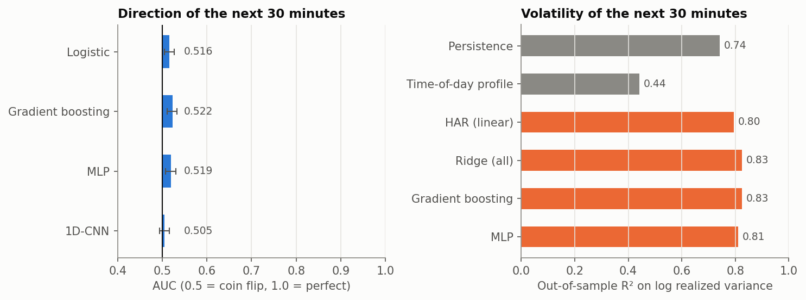

*Figure 1. The same 25 features, the same model classes, the same walk-forward years (2016–2019, 10,236 forecasts).
Left: direction AUC with 95% day-block bootstrap intervals. Right: out-of-sample R² for log realized variance.*

## 5. Results (final years 2016–2019 unless stated)

### 5.1 Direction (H1): statistically detectable, economically zero
| Model | AUC [95% CI] | Log-loss skill vs base rate | Gross points per trade (cost 0.70) |
|---|---|---|---|
| Logistic regression | 0.516 [0.505, 0.526] | −0.0002 | −0.01 |
| Gradient boosting | 0.522 [0.511, 0.533] | −0.0065 | +0.01 |
| MLP | 0.520 [0.508, 0.530] | −0.0022 | −0.03 |
| 1D-CNN (raw bars) | 0.505 [0.494, 0.516] | +0.0002 | −0.13 |
| Logistic, shuffled training labels | 0.487 | −0.0034 | −0.03 |
| Gradient boosting, shuffled labels | 0.504 | −0.0097 | +0.00 |

The share of up moves was 51.1%. Trades are long if p > 0.5 and short otherwise, held 30 minutes, on one contract.

**Pre-registered verdict: H1 is partly rejected.** We predicted every model's AUC would fall in 0.48–0.52 with an
interval containing 0.50.
- The three feature-based models land at 0.516–0.522, and their intervals exclude 0.50.
- In the development years (2012–2015), the same models scored 0.502–0.507 with intervals containing 0.50. So the
  signal is weak and not stable across periods.
- Every model's probabilities are less accurate than simply quoting the base rate (log-loss skill ≤ 0), except the CNN.
  The CNN learned to output the base rate (+0.0002).
- Every model captures far less than the 0.70-point cost (Figure 11).

The "too good" stop rule (AUC > 0.55) was not triggered.

**Post hoc (added after seeing the final results; `scripts/08_posthoc_direction.py`).** Where does an AUC of 0.52 come
from if it makes no money?
1. *Ties.* A move of exactly zero (4% of cases) counts as "down", and volatility features can predict quiet periods.
   Removing ties lowers the boosting AUC only from 0.522 to 0.519.
2. *Small moves.* The ranking skill is spread evenly over small and large moves (0.519 vs 0.520). However, the
   correlation between the predicted probability and the signed move in points is only +0.008.
3. *Confidence doesn't help.* The boosting model's most confident 10% / 20% of decisions earn +0.03 / +0.08 gross
   points per trade, still about a tenth of the cost.

In short, the features carry a faint, period-dependent hint of direction (a hint that the shuffled-label logistic model, at
0.487, also lands away from 0.50: a random linear combination of the features only does that when some features relate
to the label). It is far too small to trade.

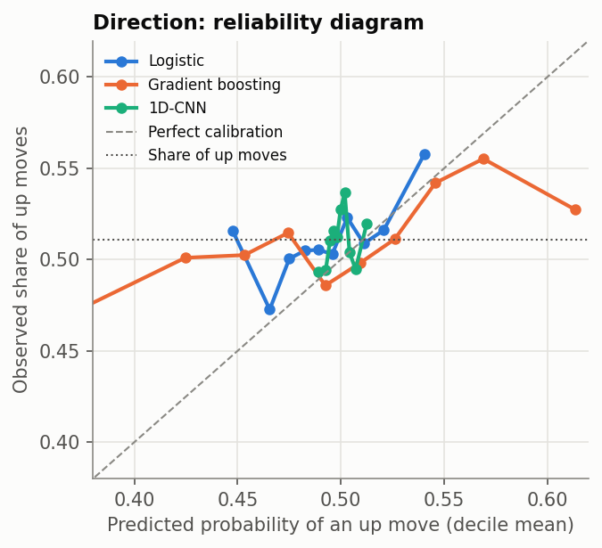

*Figure 3. Reliability diagram: predicted probabilities barely leave 0.45–0.55, and outcomes barely follow them.*

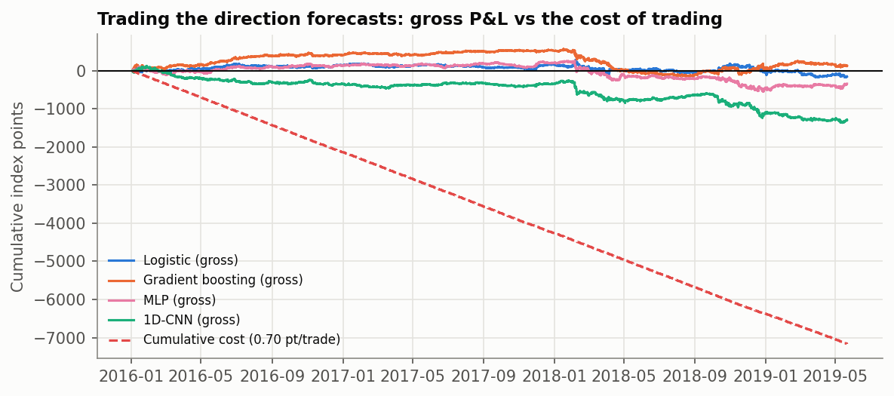

*Figure 11. Cumulative gross points from trading each direction forecast, against the cumulative cost of trading.*

### 5.2 Volatility (H2, H3): highly predictable, and machine learning helps
| Model | R² (log RV) | QLIKE ↓ | DM vs HAR: t (p) |
|---|---|---|---|
| Persistence (last 30 minutes) | 0.742 | 0.189 | −16.7 (<0.001), worse |
| Time-of-day profile | 0.442 | 0.414 | −10.9 (<0.001), worse |
| HAR, linear | 0.795 | 0.155 | — |
| Ridge, all features | 0.825 | 0.132 | +15.7 (<0.001) |
| **Gradient boosting** | **0.826** | **0.129** | **+12.3 (<0.001)** |
| MLP | 0.811 | 0.140 | +5.9 (<0.001) |

DM is the Diebold–Mariano test on daily-averaged squared errors, with Newey–West errors (Diebold & Mariano, 1995).
QLIKE is the volatility loss that is robust to noisy proxies (Patton, 2011).

- **H2 supported:** R² = 0.83, more than double the pre-registered bar of 0.40.
- **H3 supported:** gradient boosting beats HAR overall (p < 10⁻³⁰) and in each of the four years. Per-year R²: 0.80
  (2016), 0.59 (2017, the calmest year on record, with little variance to explain), 0.85 (2018), 0.75 (2019).
- A regularized linear model with all features does about as well as boosting. Most of the gain over HAR comes from
  the extra inputs (time of day, VIX, range, FOMC), not from non-linearity.
- The forecast also separates large from small moves: AUC 0.69 for "the absolute move will be above the median". Size
  is predictable even though sign is not.

**What the model uses** (permutation importance, Figure 4):
- recent volatility (last 30 minutes, then the day so far);
- time of day (Figure 10: the intraday volatility "smile" is high at the open and close, low at lunch);
- today's range, overnight volatility, FOMC days and VIX.

Every input has an economic reason. Both noise columns rank last (23rd and 24th of 25), passing the sanity check.

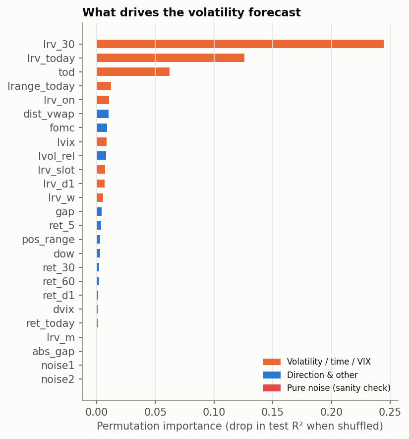
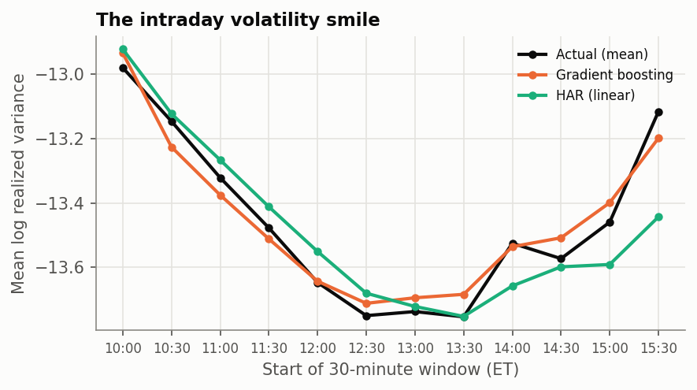

### 5.3 Intervals that hold up in a storm (H4)
Target: 90% intervals for the next 30 minutes' high-low range.

| Method | Coverage | Coverage, top-third VIX | Coverage, 2018 | Worst rolling coverage (250 forecasts) | Median width (points) |
|---|---|---|---|---|---|
| Constant (training quantiles) | 83.5% | 63.3% | 67.5% | 12.4% | 7.50 |
| Quantile gradient boosting | 72.0% | 57.3% | 58.5% | 32.8% | 3.47 |
| + split conformal (CQR) | 84.3% | 74.4% | 68.5% | 45.6% | 5.00 |
| **+ adaptive conformal (ACI)** | **90.0%** | **88.9%** | **89.5%** | **83.2%** | **5.27** |

**H4 supported.** Each method fails in its own way:
- *Raw quantile regression* is overconfident.
- *Split conformal* is calibrated for the past. It fixes coverage in calm years but cannot react when volatility doubles.
- *Constant intervals* are wide when it is calm and useless when it is not.

Adaptive conformal widens after each miss and narrows after each hit, so it stays on target through February 2018
(Figure 2) and the late-2018 sell-off (Figure 5). Its median interval is also about a third narrower than the constant
one.

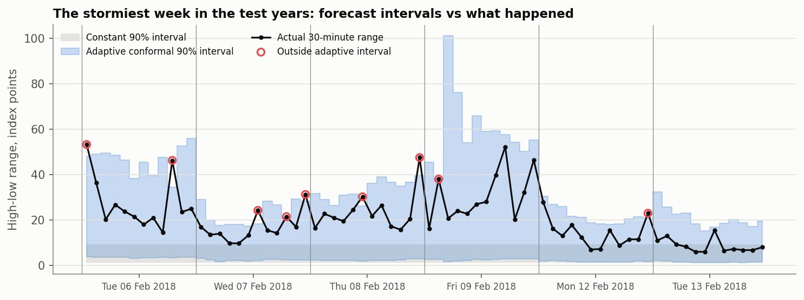

*Figure 2. The stormiest week of the test years (the February 2018 "Volmageddon"): actual 30-minute ranges against the
adaptive and constant 90% intervals.*

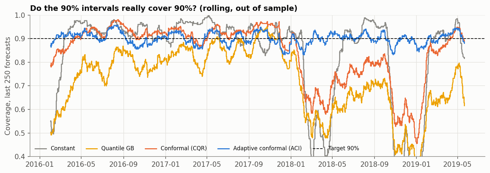

*Figure 5. Rolling coverage of each 90% interval method. Only adaptive conformal stays near its target.*

### 5.4 Market regimes (H6)
The HMM is refit each year on earlier data and read only through its filtered probabilities: the regime for day D uses
data through day D−1.

| Regime (known before the day opens) | Days | Daily volatility (from mean log RV) | Mean return | Return SD | Up days |
|---|---|---|---|---|---|
| Calm | 547 | 0.37% | +1.9 bp | 36 bp | 52.1% |
| Normal | 213 | 0.62% | +1.4 bp | 78 bp | 54.9% |
| Storm | 106 | 1.02% | +0.0 bp | 119 bp | 53.8% |

**H6 supported:**
- **Volatility:** the regime separates next-day volatility strongly (Kruskal–Wallis p = 10⁻⁸⁹; it explains 51% of the
  variance).
- **Direction:** it says nothing about next-day direction (p = 0.57; η² = 0.0001). The AUC of P(storm) for an up day
  is 0.51.

Unsupervised learning finds the same thing as supervised learning: structure in risk, none in direction.

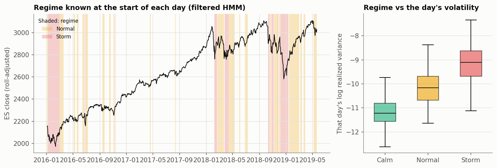

### 5.5 What volatility forecasts are good for: risk (H7)
Hold one long position in every 30-minute slot. Compare constant size with size proportional to 1 / forecast
volatility, both scaled to the same average size of one contract. This is the idea behind volatility-managed portfolios
(Moreira & Muir, 2017).

| Sizing | Kurtosis of slot P&L | Daily loss-limit breaches (3× limit) | Worst day (SD units) | Year-to-year risk ratio (max/min SD) |
|---|---|---|---|---|
| Constant | 11.4 | 4.04% | −6.3 | 2.73 |
| Persistence forecast | 4.8 | 0.12% | −2.4 | 1.12 |
| HAR forecast | 3.9 | 0.46% | −2.4 | 1.14 |
| Gradient boosting forecast | 4.0 | 0.23% | −2.2 | 1.13 |
| Oracle (true future volatility) | −0.2 | 0.00% | −1.5 | 1.13 |

The daily loss limit is 3× the mean absolute daily P&L of constant sizing.

**H7 supported:** forecast-based sizing makes risk far more stable. This matters directly for funded trading accounts,
whose daily loss limits are hard rules. Two notes:
- Even the simplest forecast (the last 30 minutes) captures most of the benefit; the ML forecast's extra accuracy
  matters less here than in §5.3.
- The higher average P&L of the scaled schemes reflects the well-known tendency of markets to fall when volatile. It is
  not an edge and we do not claim one.

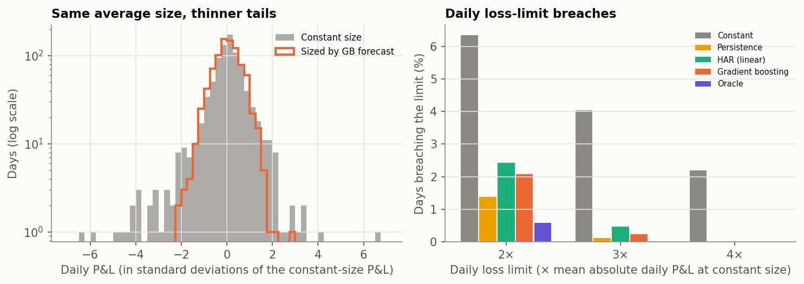

### 5.6 Leak lab (H5): manufacturing skill from nothing
The leak lab uses development data only (test years 2012–2015). Each row adds one planted mistake to the honest
pipeline.

| Mistake | Honest | With the mistake |
|---|---|---|
| L1 Centered window: a 30-minute return centered on the decision (15 minutes of future) | AUC 0.507 | **0.763** |
| L2 Off-by-one bar: momentum features include the first bar of the forecast horizon | 0.507 | 0.524 |
| L3 Overlapping labels + shuffled 5-fold CV ("up by the close?" asked at every decision time; random forest) | 0.495 (walk-forward) | **0.958** |
| L4 Smoothed HMM regimes: forward-backward probabilities of the same day, on the volatility task | R² 0.700 | 0.701 |
| L5 Scaler fit on train + test data | 0.502 | 0.502 |
| L6 Best of 200 random models, picked on 2012–13 | 0.512 (on 2014–15) | 0.511 (on 2012–13) |
| L6b Best of 200 as trading rules, picked each quarter *(post-hoc supplement, amendment A3)* | Sharpe −0.66 next quarter | Sharpe **3.65** in its quarter |

**H5 partly supported:** as predicted, L1 and L3 produce dramatic fake skill, and L5 does nothing. Against our
predictions:
- **L2** produced only a small effect. But 0.524 is exactly the kind of plausible, publishable-looking edge that is the
  most dangerous leak: nobody hunts for bugs in a 0.52.
- **L4** produced nothing. The day's volatility is already well captured by the honest features, so smoothing adds
  almost no information. The smoothed probabilities still fail our point-in-time unit test. The library's default
  `predict_proba` is the smoothed version, a trap worth knowing.
- **L6** did not inflate on the selection years. With about 6,000 forecasts, the AUC of a useless model barely varies,
  so there is little luck to select. The same selection in trading terms (L6b) is where overfitting shows: each
  quarter's winner averaged an annualized Sharpe of 3.6, then −0.7 the following quarter (positive in only 6 of 15).
  This is the backtest-overfitting effect of Bailey et al. (2014), and the reason the trading project deflates every
  Sharpe ratio by its true number of trials.

Also notable: shuffled K-fold with non-overlapping 30-minute labels gave 0.516, a small inflation. The real danger is
shuffling *combined with* overlapping labels (López de Prado, 2018; Kaufman et al., 2012).

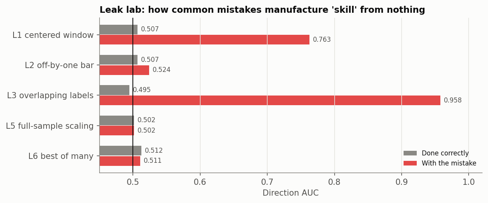
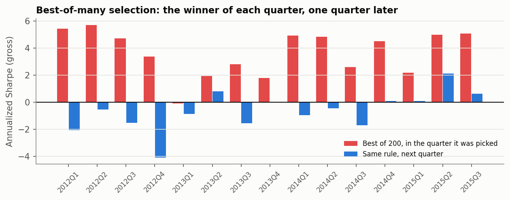

## 6. Scorecard
| Hypothesis (pre-registered) | Verdict on the final years |
|---|---|
| H1 Direction unpredictable (AUC in 0.48–0.52, CI contains 0.5, log-loss skill ≤ 0, gross < cost) | **Partly rejected.** AUC 0.516–0.522 with CIs excluding 0.5 for 3 of 4 models; CNN log-loss skill +0.0002; gross P&L ≈ 0, far below cost |
| H2 Volatility predictable (R² ≥ 0.40) | **Supported** (0.83) |
| H3 ML beats HAR (DM p < 0.05, ≥ 3 of 4 years) | **Supported** (p < 10⁻³⁰, 4 of 4) |
| H4 ACI within 90 ± 1.5% and more robust than CQR | **Supported** (90.0%; worst rolling 83% vs 46%) |
| H5 Leaks look like skill | **Partly supported** (2 large, 1 small, 3 negligible; development years) |
| H6 Regimes separate volatility, not direction | **Supported** |
| H7 Volatility sizing stabilizes risk | **Supported** |

## 7. Discussion
The project's answer to "what can ML predict?" is clear and consistent across supervised, deep, unsupervised and
conformal methods: **the size of the next move, yes; its sign, essentially no.**
- On the same inputs, the gap between R² = 0.83 and AUC = 0.52 is the efficient-market argument in numbers.
- For a trader, this re-aims machine learning. Its value here lies in *risk*: setting stops and position sizes, knowing
  when intervals widen, and avoiding daily-limit breaches. It does not lie in calling direction.
- That is also why the trading project's direction strategies failed. Their costs were larger than any predictable move.

**Methodologically,** most of the "skill" one can find in intraday direction comes from a pipeline that leaks. Two of
the six planted mistakes turned a coin flip into a model that looks excellent. The honest pipeline stayed near 0.50 in
development and reached 0.52 in the final years. That small but significant 0.52 is a useful reminder: statistical
significance and economic significance are different tests. A pre-registered cost comparison is what keeps them apart.

## 8. Limitations
- **One instrument and time span.** One instrument (ES) and one period (2010–2019); the 2020 crash is outside our data
  by design. Results may differ in other markets or at other horizons.
- **Bar data.** One-minute bars hide trading inside the minute. Costs are a fixed 0.70 points per round trip (the
  trading project's cost model), not a market-impact model.
- **Narrow risk test.** The risk test uses a constant long position: it measures risk control, not profitability.
- **No tuning.** Fixed hyperparameters keep the comparison honest but may understate what tuned models could do. A
  tuned model would face the same 0.70-point cost.
- **Undefined events.** "Volatility jumps" in the interval tests are those of 2016–2019 (chiefly February and
  December 2018). Rarer shocks could break ACI too: it reacts only after misses.
- **Post-hoc analyses.** The direction diagnostics (§5.1) and L6b were added after seeing results. They are labelled,
  and the pre-registered verdicts are reported as they came out.

## 9. Reproducibility
- `uv sync`, then `scripts/run_all.sh` reproduces the development years. `scripts/run_all.sh --final` reproduces the
  final years from tag `final-frozen`.
- Seeds are fixed, versions pinned (`uv.lock`), and the data hash is recorded in `results/data_manifest.json`.
- Tests (`uv run pytest`): point-in-time truncation of every feature (with a planted leak that must fail), reserved-data
  guards, conformal coverage on synthetic data, ACI recovery after a variance shift, and HMM filtered-vs-smoothed
  look-ahead.

## References
- Andersen, T. G., & Bollerslev, T. (1997). Intraday periodicity and volatility persistence in financial markets.
  *Journal of Empirical Finance*, 4(2–3), 115–158.
- Bailey, D. H., Borwein, J. M., López de Prado, M., & Zhu, Q. J. (2014). Pseudo-mathematics and financial charlatanism:
  The effects of backtest overfitting on out-of-sample performance. *Notices of the AMS*, 61(5), 458–471.
- Corsi, F. (2009). A simple approximate long-memory model of realized volatility. *Journal of Financial
  Econometrics*, 7(2), 174–196.
- Diebold, F. X., & Mariano, R. S. (1995). Comparing predictive accuracy. *Journal of Business & Economic Statistics*,
  13(3), 253–263.
- Fama, E. F. (1970). Efficient capital markets: A review of theory and empirical work. *Journal of Finance*, 25(2),
  383–417.
- Gibbs, I., & Candès, E. (2021). Adaptive conformal inference under distribution shift. *Advances in Neural
  Information Processing Systems*, 34.
- Hamilton, J. D. (1989). A new approach to the economic analysis of nonstationary time series and the business cycle.
  *Econometrica*, 57(2), 357–384.
- Kaufman, S., Rosset, S., Perlich, C., & Stitelman, O. (2012). Leakage in data mining: Formulation, detection, and
  avoidance. *ACM Transactions on Knowledge Discovery from Data*, 6(4).
- López de Prado, M. (2018). *Advances in Financial Machine Learning.* Wiley.
- Mandelbrot, B. (1963). The variation of certain speculative prices. *Journal of Business*, 36(4), 394–419.
- Moreira, A., & Muir, T. (2017). Volatility-managed portfolios. *Journal of Finance*, 72(4), 1611–1644.
- Newey, W. K., & West, K. D. (1987). A simple, positive semi-definite, heteroskedasticity and autocorrelation
  consistent covariance matrix. *Econometrica*, 55(3), 703–708.
- Patton, A. J. (2011). Volatility forecast comparison using imperfect volatility proxies. *Journal of Econometrics*,
  160(1), 246–256.
- Romano, Y., Patterson, E., & Candès, E. (2019). Conformalized quantile regression. *Advances in Neural Information
  Processing Systems*, 32.
- Data: Databento GLBX.MDP3 `ohlcv-1m`; Cboe VIX daily history (cdn.cboe.com, accessed 2026-11-02); Board of Governors
  of the Federal Reserve System, FOMC historical materials (federalreserve.gov/monetarypolicy/fomchistoricalYYYY.htm,
  accessed 2026-11-04).
